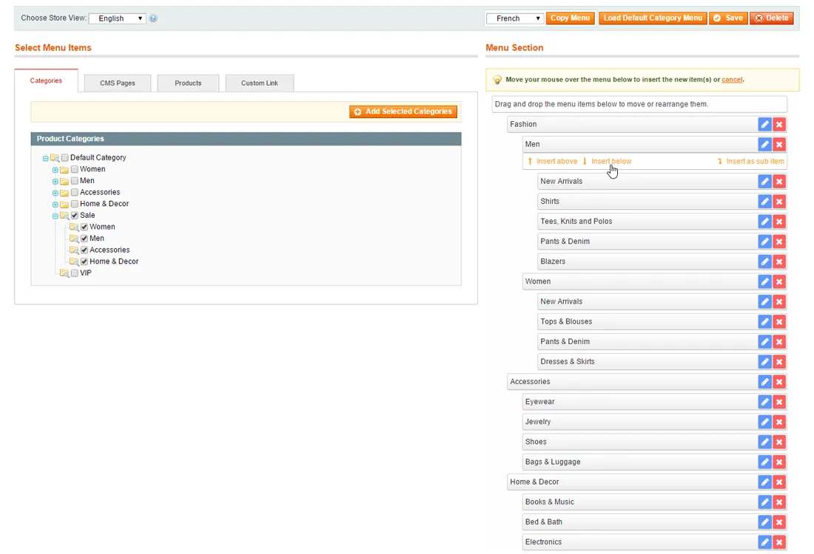
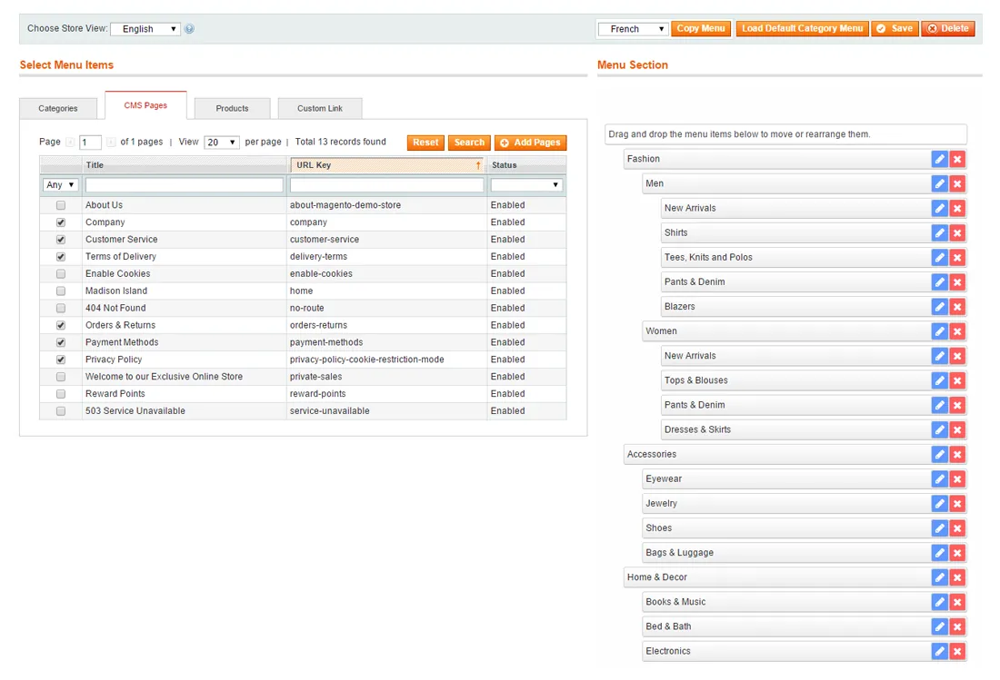
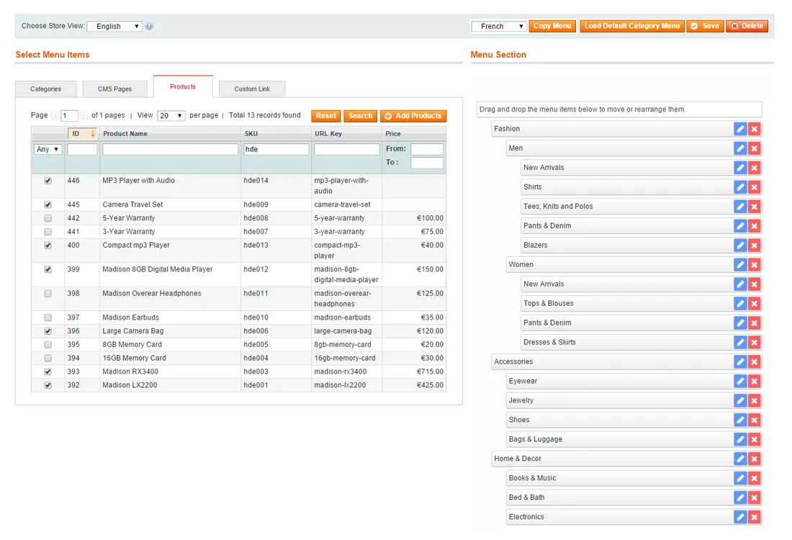
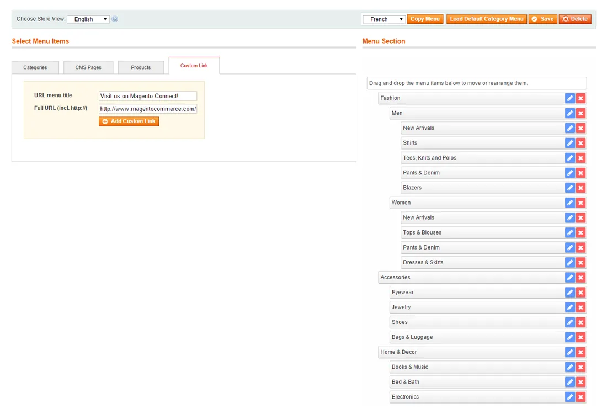
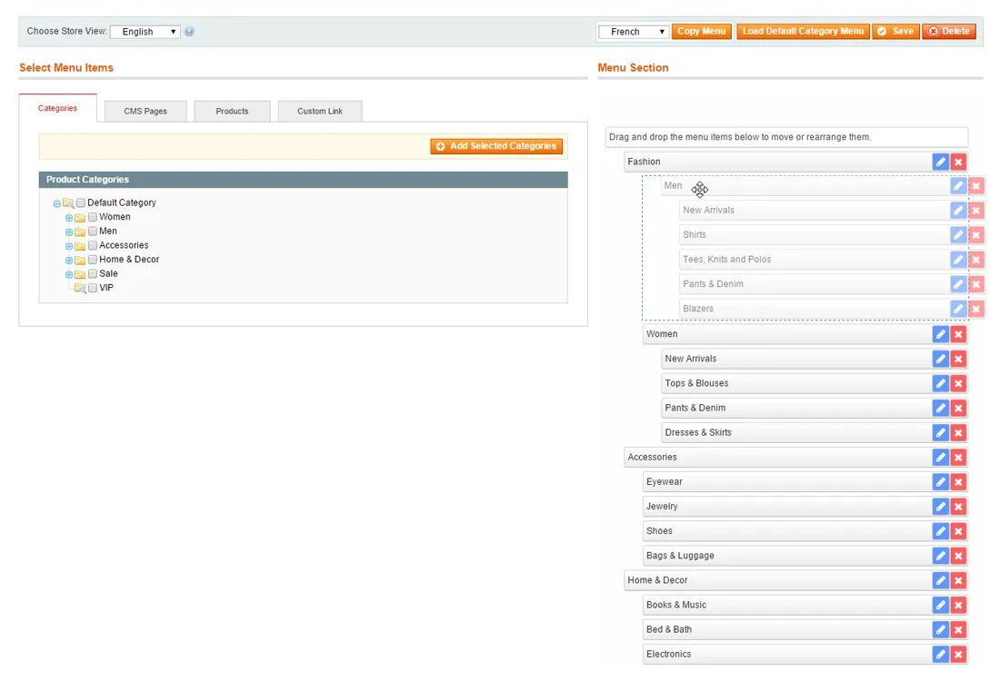
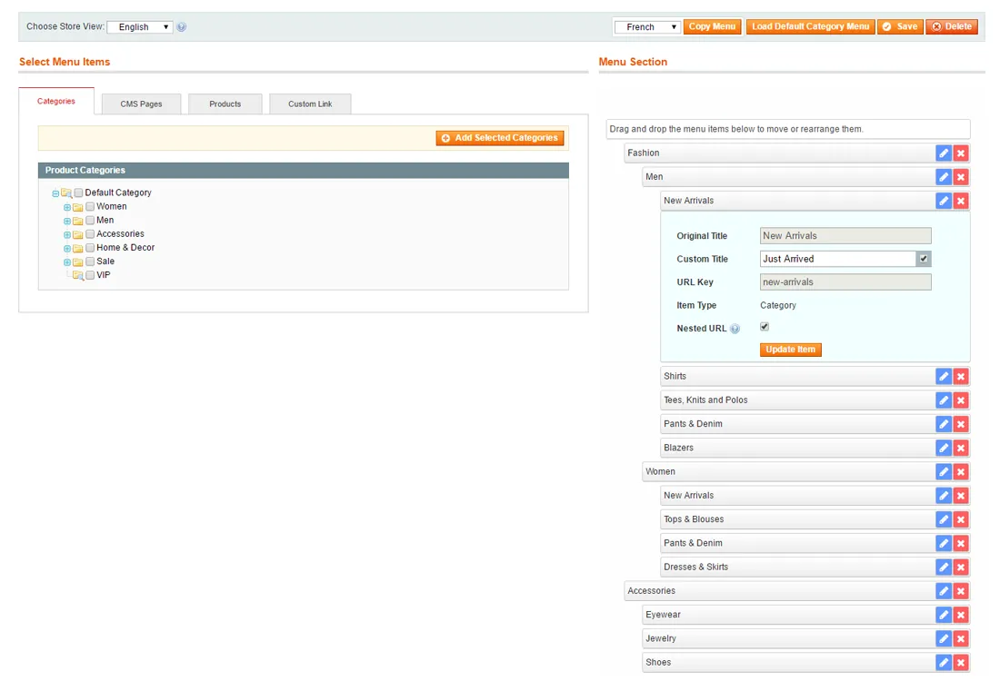
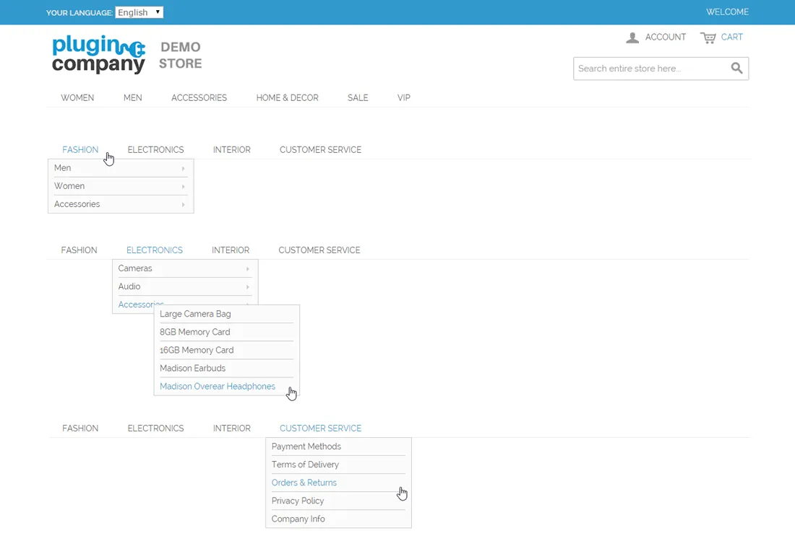

# Easy Menu for Magento 1 / OpenMage

**Drag-and-drop editor for the Magento category menu.**



Lets you customize the front-end category menu in the admin with drag and drop.

Add categories, products, CMS pages and custom links, and move or rename menu items without changing your category tree.

> [!NOTE]
> Easy Menu is free and open source under the MIT License (since 2026). Plugin Company no longer actively develops this extension, but issues and pull requests are welcome.

## Features

- Customize the front-end category menu
- Add categories, CMS pages, products and custom links
- Drag-and-drop menu editor
- Insert, move and delete menu items
- Custom menu titles and placeholder items
- Optional URL rewrites for nested menu items
- Automatic update of original menu item titles
- Separate menu per store view, with copy function
- Restore the default menu with one click

## Screenshots

<table>
  <tr>
    <td width="50%" valign="top"><br><sub>Add CMS pages</sub></td>
    <td width="50%" valign="top"><br><sub>Add product pages</sub></td>
  </tr>
  <tr>
    <td width="50%" valign="top"><br><sub>Add custom links</sub></td>
    <td width="50%" valign="top"><br><sub>Move store menu items</sub></td>
  </tr>
  <tr>
    <td width="50%" valign="top"><br><sub>Edit store menu items</sub></td>
    <td width="50%" valign="top"><br><sub>Front-end store menu examples</sub></td>
  </tr>
</table>

## Compatibility

- **Magento:** Community Edition 1.4.x – 1.9.x, Enterprise Edition 1.8.x – 1.14.x
- **Latest version:** 1.1.3 (released 2019-02-05)
- **Composer package:** `plugincompany/magento1-easy-menu`
- **Modules:** `Monkebusiness_Easymenu`, `Monkebusiness_Notifications`, `Plugincompany_Easymenu`, `Plugincompany_Notifications`

## Installation

### modman

```bash
cd /path/to/magento
modman init   # once per Magento installation
modman clone https://github.com/PluginCompany/magento1-easy-menu.git
```

modman creates symlinks, so enable *Allow Symlinks* under System > Configuration > Advanced > Developer > Template Settings.

### Composer

With [magento-hackathon/magento-composer-installer](https://github.com/Cotya/magento-composer-installer) (it reads the `modman` file of this repository):

```bash
composer config repositories.plugin.company composer https://plugin.company/
composer require plugincompany/magento1-easy-menu
```

Your project `composer.json` needs the Magento root directory in its `extra` section (and, with Composer 2.2+, the installer plugin allowed), for example:

```json
{
    "extra": { "magento-root-dir": "./" },
    "config": { "allow-plugins": { "magento-hackathon/magento-composer-installer": true } }
}
```

### Manual installation

Download the ZIP of the latest release from the [tags page](https://github.com/PluginCompany/magento1-easy-menu/tags) ([1.1.3](https://github.com/PluginCompany/magento1-easy-menu/archive/refs/tags/1.1.3.zip)) and copy the `app/`, `js/`, `media/` folders into your Magento root:

```bash
unzip magento1-easy-menu-1.1.3.zip
cp -R magento1-easy-menu-1.1.3/app magento1-easy-menu-1.1.3/js magento1-easy-menu-1.1.3/media /path/to/magento/
```

Step-by-step instructions are in the [installation guide](docs/02-installing-the-magento-extension.md).

### After installing

Clear the cache (System > Cache Management, or `rm -rf var/cache/*`), then log out of the admin and log in again so the new configuration sections and permissions are loaded.

> [!NOTE]
> Some files of this extension are also shipped by other Plugin Company Magento 1 extensions: `js/plugincompany/lib/fontawesome` (also in magento1-newsletter-popup). The original ZIP packages simply overwrote each other's copy; with modman or the Composer installer the second extension reports an existing target for these paths.

### Upgrading from a purchased copy

Replace the old files with this release. No license key is needed; your settings and data stay as they are.

## Documentation

- [Documentation in this repository](docs/README.md) (Installation Guide, User Manual, Extension FAQ)
- Online documentation: <https://plugin.company/knowledge-base/docs/magento-easy-menu/>
- Product page: <https://plugin.company/magento1-extensions/easy-menu.html>

## Changelog

See [CHANGELOG.md](CHANGELOG.md) for the release history.

## Contributing

Found a bug or have an improvement? Please open an [issue](https://github.com/PluginCompany/magento1-easy-menu/issues) or send a [pull request](https://github.com/PluginCompany/magento1-easy-menu/pulls). Since the extension is no longer actively developed by Plugin Company, fixes from the community are the best way to keep it working on current Magento 1 / OpenMage and PHP versions.

## License

Plugin Company's code in this repository is released under the [MIT License](LICENSE), Copyright (c) 2014-2026 Plugin Company.

Bundled third-party libraries keep their own licenses; see [THIRD-PARTY-NOTICES.md](THIRD-PARTY-NOTICES.md) for the full list.

In particular:

- The license of some bundled files could not be determined or verified (Fontello-generated icon font).
