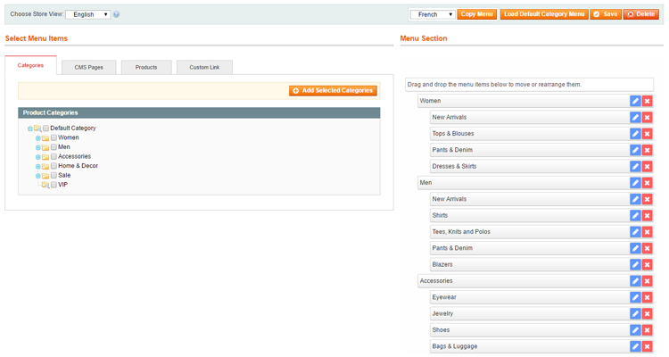

# Customizing the Magento Store Menu

After installing Magento Easy Menu, you can customize your front-end store category menu by navigating to **System > Manage Easy Menu** in the top Admin Panel menu.

Using the Easy Menu drag and drop interface, new menu items can be selected on the left side of the page and inserted in the right hand Menu Section.

You can customize the menu of one store view at a time. If you have multi-store setup, first make sure to select the right store view in the top left corner of the page.

Use the buttons in the top right corner of the interface to copy, load, save and store menus.

To copy the menu of other store views, select a store from the dropdown menu and click the 'Copy Menu' button.

You can load and recover the default store menu at any time by clicking the 'Load Default Category Menu' button.

Click the 'Delete' button to remove all menu items. If an empty menu is saved, the default category menu will be shown in the front-end store.

---

[Documentation index](./README.md) · [README](../README.md) · [Online version](https://plugin.company/knowledge-base/docs/magento-easy-menu/user-manual/customizing-the-magento-store-menu/)
