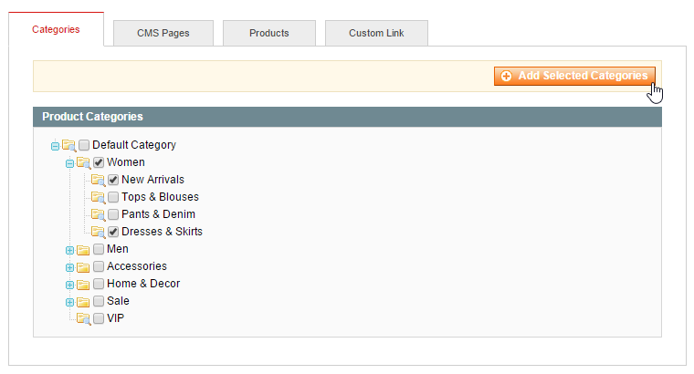
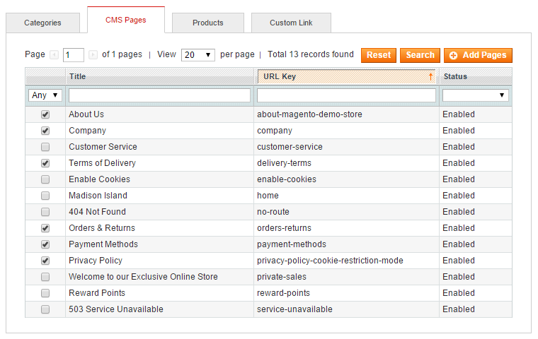
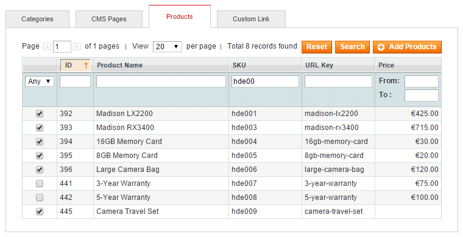
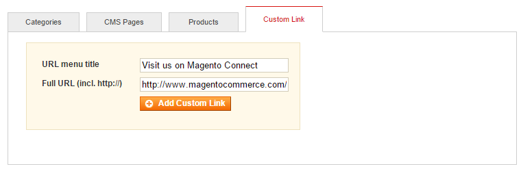

# Selecting Menu Items

You can add product categories, CMS pages, products and custom links to your store menu by selecting them from one of the four tabs on the left side of the Easy Menu interface.

## Categories

Open the Categories tab to select your store's product categories and click the 'Add Selected Categories' button to add them to the menu.

## CMS Pages

Use the CMS Pages tab to select your store's CMS pages and click the 'Add Pages' button to add them to the menu.

## Products

Open the Products tab to select products from your store's catalog and click the 'Add Products' button to add them to the menu.

## Custom Link

Use the Custom Link tab to add custom URLs and placeholder items to the menu.

Enter the link's menu title and full URL and click the 'Add Custom Link' button to add it to the menu.

If you would like to create a non-clickable placeholder menu item, simply leave the URL field empty.

---

[Documentation index](./README.md) · [README](../README.md) · [Online version](https://plugin.company/knowledge-base/docs/magento-easy-menu/user-manual/selecting-menu-items/)
