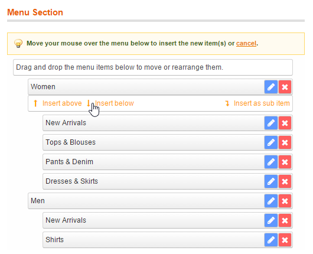
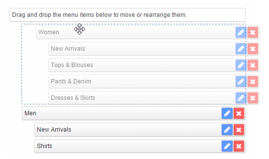

# Adding and Moving Menu Items

When adding items to an empty menu they will be automatically inserted in the Menu Section on the right side of the Easy Menu interface.

When adding items to an existing menu, an options bar will appear when moving your mouse over the Menu Section, which can be used to insert the new item(s) above or below existing menu items, or add them as a sub item.

Click 'cancel' at the top of the Menu Section to cancel the menu item insertion.

All items in the Menu Section can be moved and rearranged by dragging and dropping them on any desired position in the menu.

When selecting a menu item that contains sub items, the sub items will be automatically selected and moved as well.

---

[Documentation index](./README.md) · [README](../README.md) · [Online version](https://plugin.company/knowledge-base/docs/magento-easy-menu/user-manual/adding-and-moving-menu-items/)
