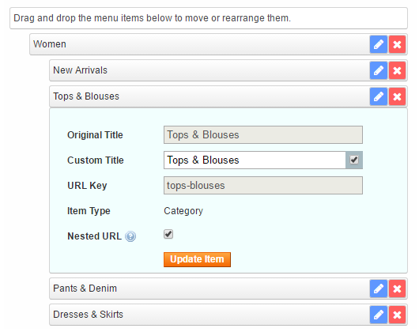

# Editing and Removing Menu Items

Click the blue pencil icon on the right side of a menu item to view or edit its details,

You can choose to use the original menu item title (the title given to a CMS page, category or product) or customize it by ticking the checkbox next to the 'Custom Title' input field. If the original title is used, the menu item will be automatically updated when the title of a CMS page, category or product is changed. The default menu item titles are also adjusted / translated automatically when copied to a different store view.

The 'Nested URL' option can be used to automatically create URL rewrites for menu items in accordance with the custom store menu hierarchy, while preserving the item's original URL.

Click 'Update Item' to save any changes made to a menu item.

Click the red x icon to remove the item from the menu.

---

[Documentation index](./README.md) · [README](../README.md) · [Online version](https://plugin.company/knowledge-base/docs/magento-easy-menu/user-manual/editing-and-removing-menu-items/)
